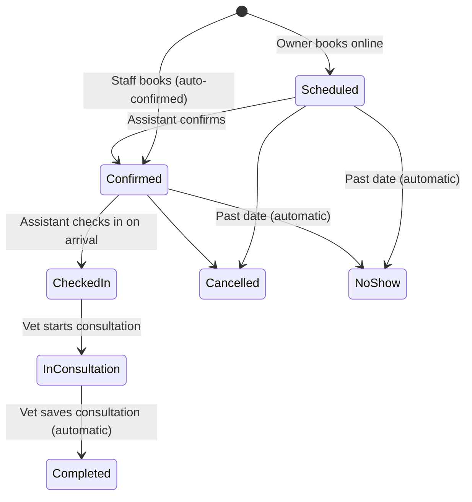

# Clinic process (automated in the UI)

The proposal lists the modules but not the step-by-step flow, so the system follows the standard veterinary patient flow:
book → confirm → check in → consult → vaccinate/treat → follow-up reminder.

| Step | Who | Automation |
|---|---|---|
| Register owner and pet | Assistant / Admin | Validated forms, duplicate checks |
| Book | Owner or staff | Owner bookings start as Scheduled, staff bookings as Confirmed. Clinic hours and double-booking checks |
| Confirm, check in | Assistant | Only valid next steps appear as buttons |
| Start consultation | Veterinarian | Opens the consultation form for that patient |
| Save consultation | Veterinarian | Visit is marked Completed automatically |
| Vaccinate | Vet / Assistant | Next dose date auto-filled from the vaccine (1 year, deworming 90 days). Earlier dose of the same vaccine is closed |
| Remind | System | Overdue / due-soon lists on dashboards |
| Missed visit | System | Past Scheduled/Confirmed visits become No-show on load |
| Audit | System | Admin overview shows recent activity |
